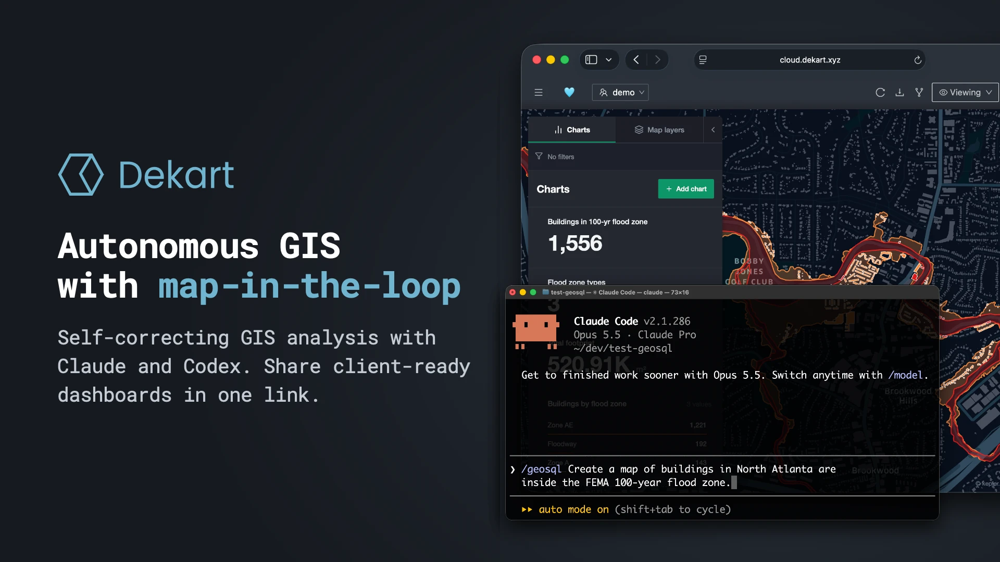
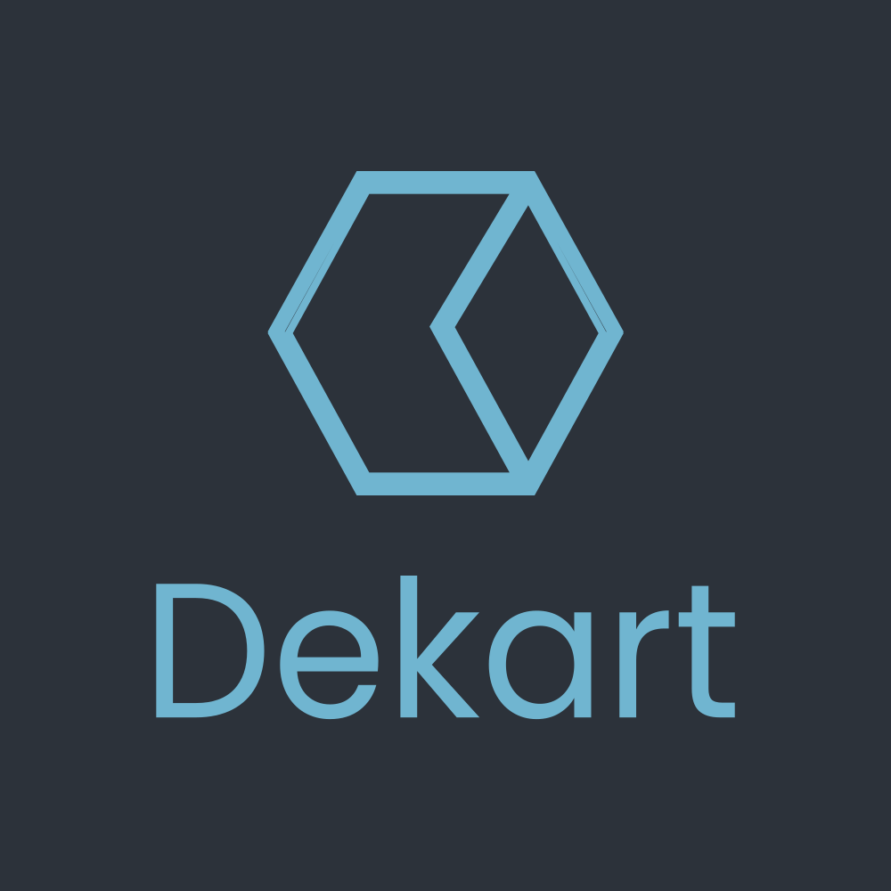

<article class="pb-5">

<h1>Brand Assets</h1>

Logos and banners for videos, newsletters, and articles about Dekart. Use them as they are; please do not recolor or stretch the logo.

<h2>Banner</h2>

Product banner with the Dekart logo, tagline, and a live map. Use 1920×1080 for video and 1200×600 for newsletters and social posts.

<a class="btn btn-outline-primary" href="/brand/dekart-banner-1920x1080.png" download>PNG 1920×1080</a><a class="btn btn-outline-primary" href="/brand/dekart-banner-1200x600.png" download>PNG 1200×600</a>

<h2>Square logo</h2>

Logo with wordmark for thumbnails and sponsor tiles.

<a class="btn btn-outline-primary" href="/brand/dekart-logo-square.png" download>PNG 1000×1000</a><a class="btn btn-outline-primary" href="/brand/dekart-logo-square.svg" download>SVG</a>

<h2>Avatar</h2>

Icon only, for small square spaces and profile images.

<a class="btn btn-outline-primary" href="/brand/dekart-avatar.png" download>PNG 1024×1024</a><a class="btn btn-outline-primary" href="/brand/dekart-avatar.svg" download>SVG</a>

<h2>Horizontal logo</h2>

Transparent background, for headers and lower thirds. Works on dark and light backgrounds.

<a class="btn btn-outline-primary" href="/brand/dekart-logo.png" download>PNG 1752×416</a><a class="btn btn-outline-primary" href="/brand/dekart-logo.svg" download>SVG</a>

</article>
